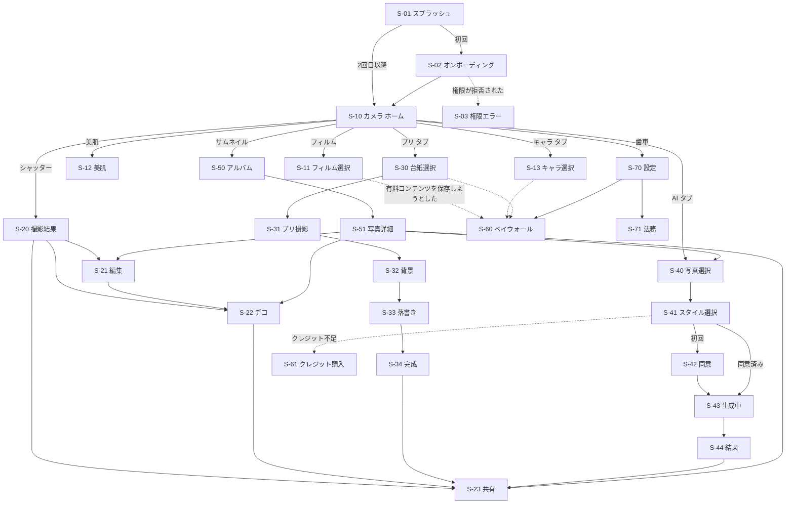

# 05. 画面一覧・画面遷移

## 1. 画面一覧

| ID       | 画面                 | 概要                                                                                                                                                                            | 関連する要件               |
| -------- | -------------------- | ------------------------------------------------------------------------------------------------------------------------------------------------------------------------------- | -------------------------- |
| S-01     | スプラッシュ         | 起動。コンテンツのマニフェストを裏で取得する                                                                                                                                    | CNT-01                     |
| S-02     | オンボーディング     | 4モードの紹介（3画面以内）と権限の説明                                                                                                                                          | ONB-01, ONB-02             |
| S-03     | 権限エラー           | カメラや写真へのアクセスが拒否されたときに、設定への導線を出す                                                                                                                  | ONB-02                     |
| **S-10** | **カメラ（ホーム）** | 加工したプレビュー、シャッター、モード切り替えタブ（フィルム / キャラ / プリ / AI）、前後カメラの切り替え、フラッシュ、タイマー、アスペクト比、美肌ボタン、アルバムのサムネイル | CAM-_, FLM-_, BTY-_, CHR-_ |
| S-11     | フィルム選択シート   | フィルムの一覧（無料 / 有料 / NEW / お気に入り）、強さのスライダー、日付印字のオン/オフ                                                                                         | FLM-01〜08                 |
| S-12     | 美肌シート           | 美肌の強さ、肌のトーン、顔の微調整                                                                                                                                              | BTY-01〜06                 |
| S-13     | キャラ選択シート     | キャラの一覧と色違い                                                                                                                                                            | CHR-01〜05                 |
| S-20     | 撮影結果             | 撮った写真の確認。「保存」「編集」「デコ」「共有」「撮り直し」                                                                                                                  | SHR-_, EDT-_               |
| S-21     | 編集                 | フィルムの変更、美肌の再調整、基本補正、トリミング                                                                                                                              | EDT-01〜05                 |
| S-22     | デコ                 | ペン、ネオンペン、スタンプ、テキスト、日付、消しゴム                                                                                                                            | DCO-01〜05                 |
| S-23     | 共有                 | OS の共有シート、Instagram ストーリーズ、保存サイズの選択                                                                                                                       | SHR-01〜05                 |
| **S-30** | **プリ: 台紙選択**   | レイアウト（2〜6コマ）の選択                                                                                                                                                    | PRI-01                     |
| S-31     | プリ: 撮影           | カウントダウン付きの連続撮影、ポーズ指示、プリ風の補正、撮り直し                                                                                                                | PRI-02, PRI-03, PRI-07     |
| S-32     | プリ: 背景           | 背景の差し替え                                                                                                                                                                  | PRI-04                     |
| S-33     | プリ: 落書き         | コマごとの落書き（S-22 の部品を使い回す）                                                                                                                                       | PRI-05                     |
| S-34     | プリ: 完成           | 台紙に合成したプレビュー、保存、共有                                                                                                                                            | PRI-06                     |
| **S-40** | **AI: 写真選択**     | アルバムか端末の写真から1枚を選ぶ                                                                                                                                               | AI-01                      |
| S-41     | AI: スタイル選択     | スタイルの一覧、クレジットの残高、消費クレジットの表示                                                                                                                          | AI-02, AI-07               |
| S-42     | AI: 同意             | 初回だけ表示。送信・保存期間・学習に使わないこと・他人の写真を使わないこと                                                                                                      | AI-03                      |
| S-43     | AI: 生成中           | 進捗表示（キャンセル可）                                                                                                                                                        | AI-04                      |
| S-44     | AI: 結果             | 結果の表示、保存、共有、通報、別のスタイルで再生成                                                                                                                              | AI-04〜06                  |
| S-50     | アルバム             | 撮影履歴の一覧、選択、削除                                                                                                                                                      | ALB-01〜03                 |
| S-51     | 写真詳細             | 1枚の表示。編集、デコ、共有、AI 変身、削除                                                                                                                                      | ALB-_, EDT-_, AI-*         |
| S-60     | ペイウォール         | プラン比較（年額 / 買い切り）、トライアル、必須表示の項目                                                                                                                       | PAY-01〜07                 |
| S-61     | クレジット購入       | AI クレジットのパックと年額プランの案内                                                                                                                                         | PAY-03                     |
| S-70     | 設定                 | 保存画質、位置情報の削除、シャッター音、元画像の保持期間、購入の復元、お問い合わせ                                                                                              | SET-01〜04                 |
| S-71     | 法務                 | 利用規約、プライバシーポリシー、特商法の表記、ライセンス                                                                                                                        | SET-02                     |

## 2. 画面遷移（概要）



## 3. カメラ画面（S-10）のレイアウト案

```
┌─────────────────────────────┐
│ ⚡  ⏱  3:4        ⚙        │ ← 上部: フラッシュ / タイマー / アスペクト比 / 設定
│                             │
│                             │
│      【加工プレビュー】       │
│                             │
│                    '26 10 24│ ← 日付印字のプレビュー
│                             │
├─────────────────────────────┤
│ [CCD] [ガラケー] [写ルン風]… │ ← 選んでいるモードの素材を横スクロール
│  美肌✨        強さ ━━●━━   │
│                             │
│ 🖼      (  ◯  )       🔄    │ ← アルバム / シャッター / カメラ切り替え
│  フィルム  キャラ  プリ  AI   │ ← モードのタブ
└─────────────────────────────┘
```

- 撮影の主な操作（シャッター・モード・素材の選択）は、すべて片手（親指の届く範囲）で完結させる
- 写真の上に重ねる UI は、半透明の背景と影で読みやすくする
- デザインのトーン: 10代の女の子に刺さる「平成スイーツ × 今っぽい」かわいさ。実装は `apps/mobile/src/ui/` に集約
  - 配色: クリーム地にピンク・ラベンダー・ミント・レモンのパステル、文字はプラム色。主ボタン・選択中・シャッターはピンク→ラベンダーのグラデーション、プレミアムはレモン→ピンク（`theme.ts`）
  - 形: 角丸の大きいカード・ピル型ボタン・ピンクのやわらかい影。プレビューと写真は角丸の「プリント」として置く。フィルムはミニチェキ風のサムネイルを少し傾けて並べる
  - 文字: M PLUS Rounded 1c（丸ゴシック）。文言は親しみのある口語と絵文字（読み上げラベルと規約・購入条件は平易な文のまま）
  - 操作感: タップできるものはすべて「ぷにっ」と縮んで戻るアニメーションと軽い振動（設定でオフにできる）。シャッターはハート、カウントダウンや選択はポップに弾む。空の状態や案内には浮かぶ絵文字
