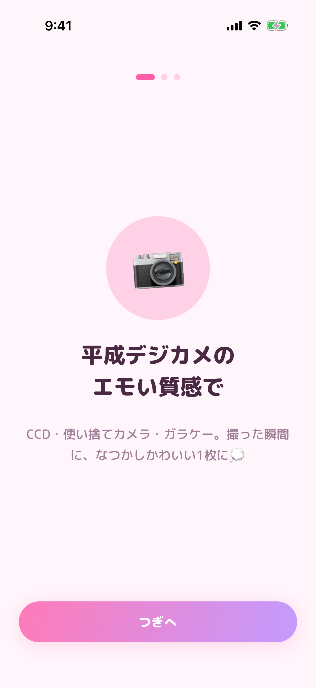
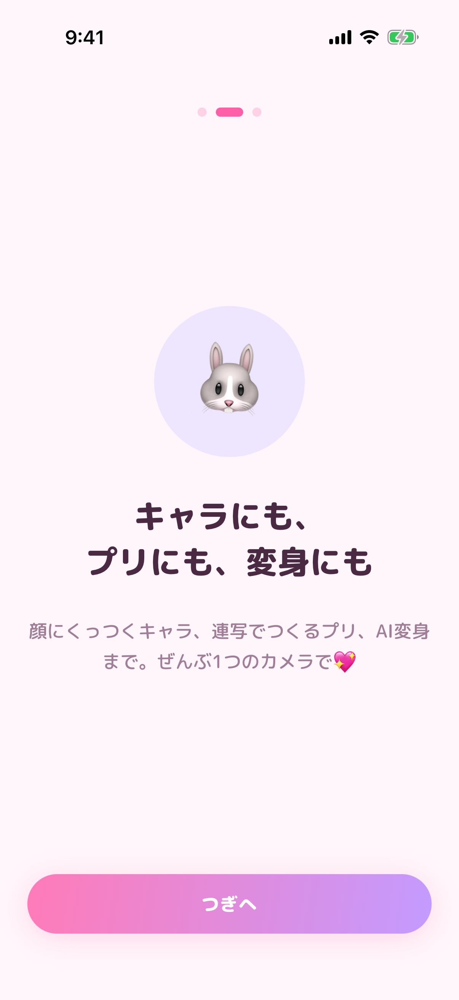
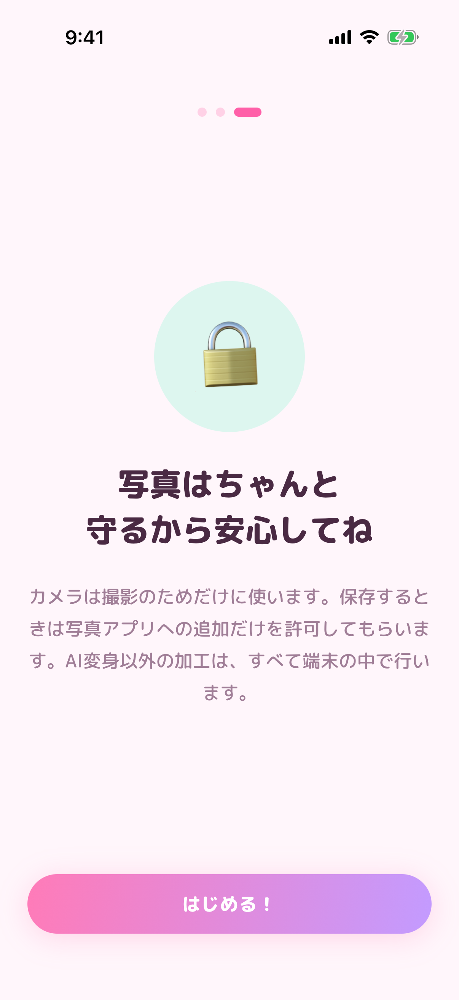
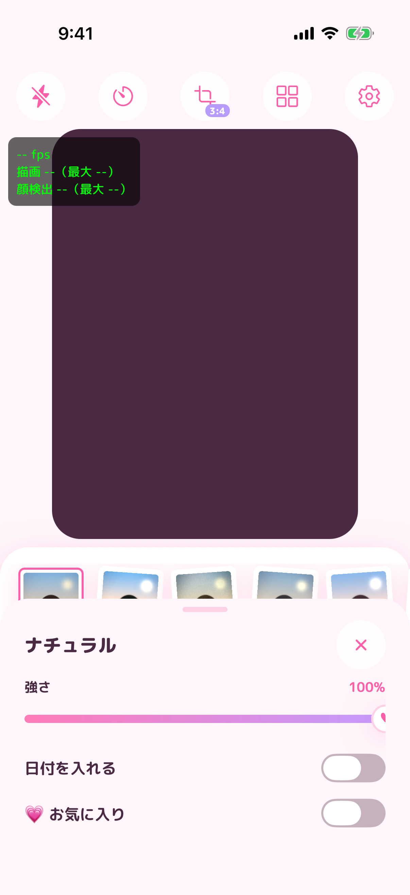
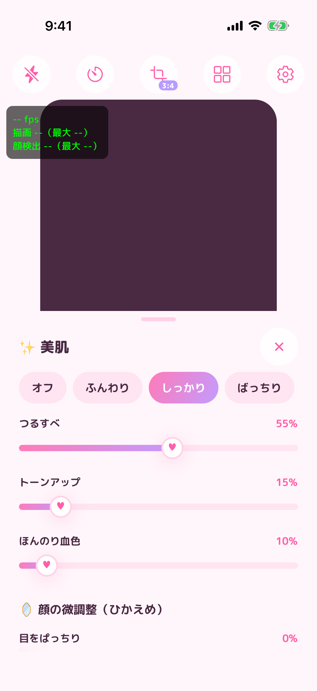
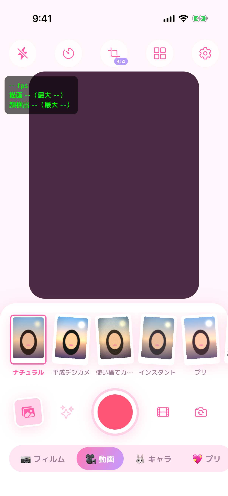
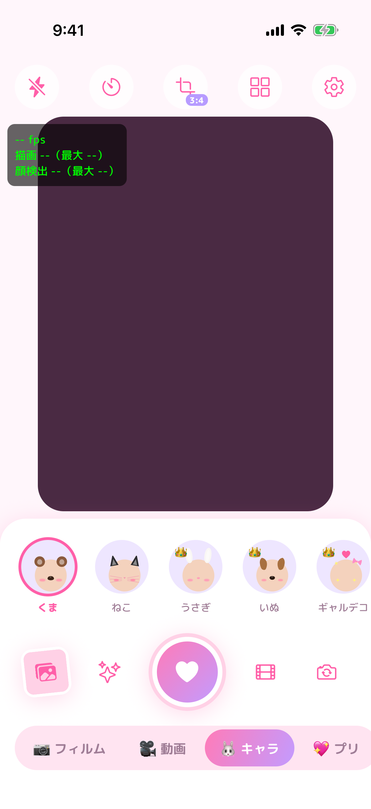
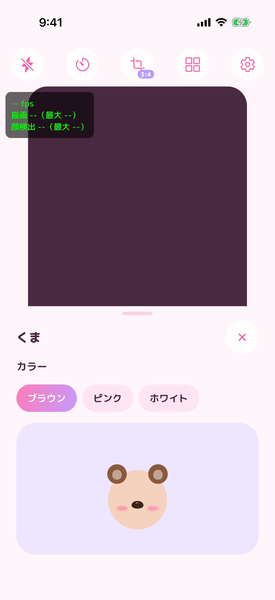
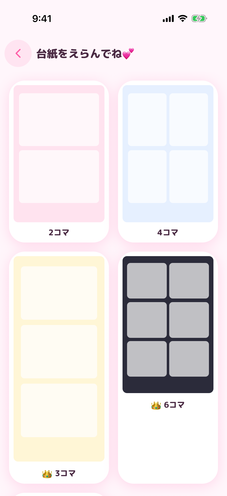
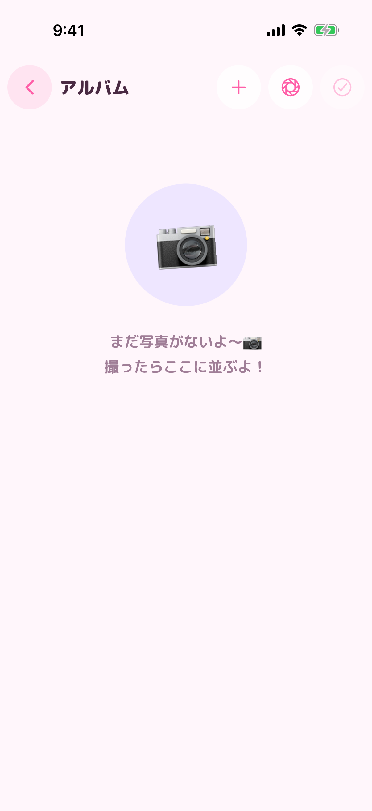

# 画面のスクリーンショット（iOS シミュレーター）

| 項目   | 内容                                                                                                                                           |
| ------ | ---------------------------------------------------------------------------------------------------------------------------------------------- |
| 撮影日 | 2026-10-31 |
| 端末   | iPhone 17 Pro シミュレーター（iOS 26.4）、日本語                                                                                               |
| ビルド | 開発用（`com.fant.camera.dev`）の Release ビルド、コミット b242a31 |
| 撮り方 | `.github/workflows/screenshots.yml` が Maestro で `apps/mobile/e2e/screenshots.yaml` の操作を行って撮影する（手動実行または e2e の変更で動く） |

**注意**: シミュレーターにはカメラがないため、カメラ画面のプレビューは暗い四角のままです（実機ではここにフィルムをかけた映像が映ります）。プレビューの左上の緑の文字は開発用ビルドだけに出る性能表示です。

## 初回の案内（S-02）

| 1                                                      | 2                                                          | 3                                                            |
| ------------------------------------------------------ | ---------------------------------------------------------- | ------------------------------------------------------------ |
|  |  |  |

## カメラ（S-10）

| フィルムの設定                                        | 美肌                                            | 動画モード                                               |
| ----------------------------------------------------- | ----------------------------------------------- | -------------------------------------------------------- |
|  |  |  |

| キャラモード                                 | キャラのカラー                                           | プリの台紙（S-30）                           |
| -------------------------------------------- | -------------------------------------------------------- | -------------------------------------------- |
|  |  |  |

## アルバム（S-50）

| 写真がないとき                          |
| --------------------------------------- |
|  |

## まだ撮れていない画面

撮影の自動操作の手順を直して撮り直し中です。撮れたら追加します。

- 設定・プレミアム（課金画面）・ライセンス: 直前に開いたキャラのシートが画面上部のボタンを覆い、設定を開くタップが届かなかった
- 写真の編集（全タブ）・写真画面・動かす・デコ: 写真ピッカーで写真をタップする位置がずれていた（見本の写真は一覧の先頭にある）
- コラージュ・HDR合成・パノラマ・AI: 撮影の手順にまだない
